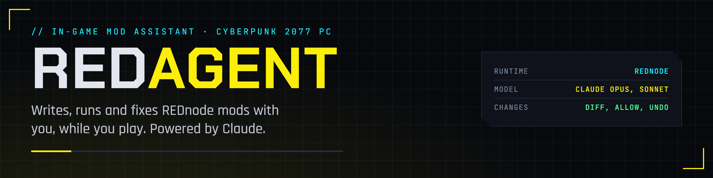
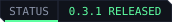
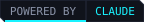
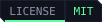

  

  
  
  
  
  

An assistant inside Cyberpunk 2077 that writes, runs, checks and fixes [REDnode](https://github.com/Edgemodders/REDnode) mods and overlay apps with you, while you play. Powered by Claude.

You ask, in a chat window in the game: "make me a mod that warns me when my health drops below 30%". REDagent writes the mod, REDnode's hot reload runs it, REDagent reads the mod's log and checks the game's answers through REDnode's game API, and fixes what is wrong. Every change to a file is shown to you first as a diff, and can be undone.

**[Read the guide](https://edgemodders.github.io/REDagent/guide.html)** &middot; [Docs](https://edgemodders.github.io/REDagent/) &middot; [Design](docs/design.md) &middot; [REDnode](https://github.com/Edgemodders/REDnode) &middot; [REDcode](https://github.com/Edgemodders/REDcode)

> [!NOTE]
> **Status: 0.3.1 released on 2026-10-24**, for game 2.31: [Nexus Mods](https://www.nexusmods.com/cyberpunk2077/mods/35670) or [GitHub releases](https://github.com/Edgemodders/REDagent/releases). Needs [REDnode](https://www.nexusmods.com/cyberpunk2077/mods/35419). Phases C1 to C5 passed in game; 0.3.1 uses other mods' tools. Phases and results are in [docs/design.md](docs/design.md); players start with the [guide](https://edgemodders.github.io/REDagent/guide.html).

## Install (developers)

1. Deploy [REDnode](https://github.com/Edgemodders/REDnode) to the game.
2. `cd redagent && npm install`
3. `.\tools\deploy.ps1 -GameDir '<your Cyberpunk 2077 folder>'`
4. In the game, allow REDagent to use REDnode's tools in the REDnode Mod Manager, then paste your API key into REDagent.

`node tools/check-key.mjs` checks a key outside the game. `.\tools\brand\render.ps1` renders the banner, icon and badges.

| You need | Why |
|---|---|
| Cyberpunk 2077 on PC with REDnode | REDagent is a REDnode package |
| Your own Anthropic API key | REDagent calls Claude with your key, and you pay for what you use. No key ships with the mod |

Not affiliated with CD Projekt RED or Anthropic.
